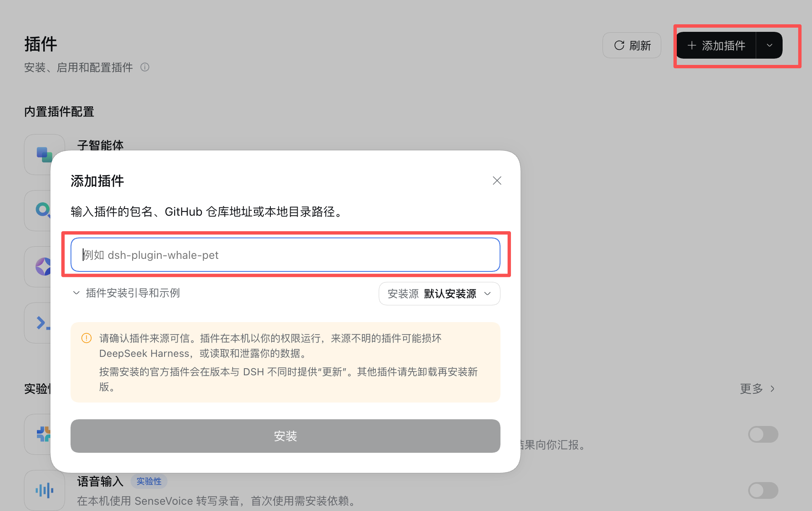
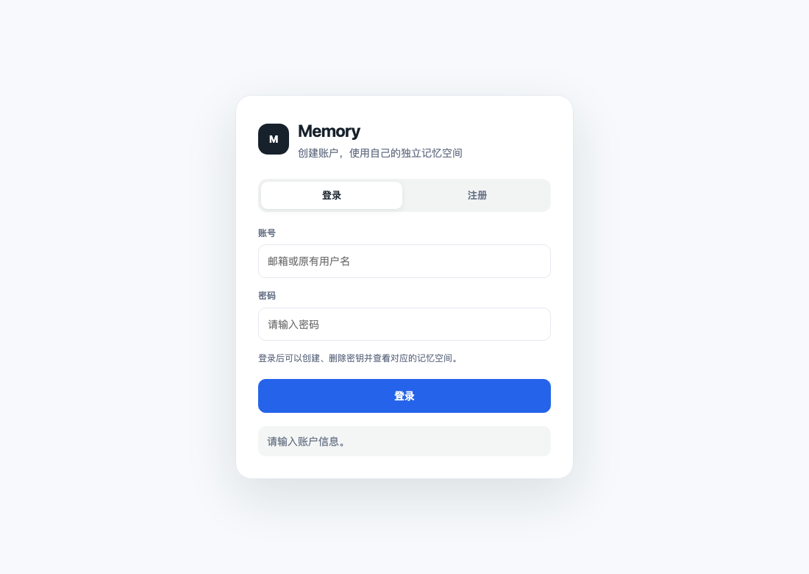
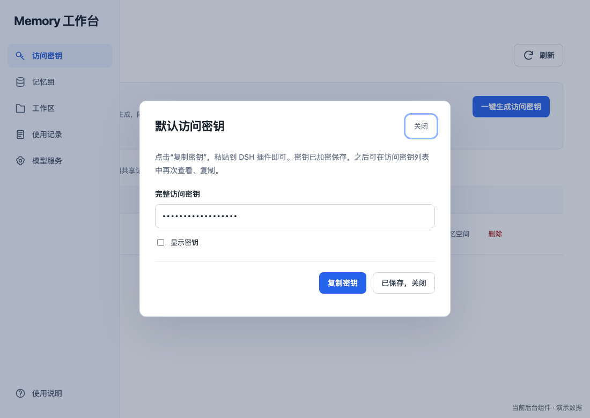
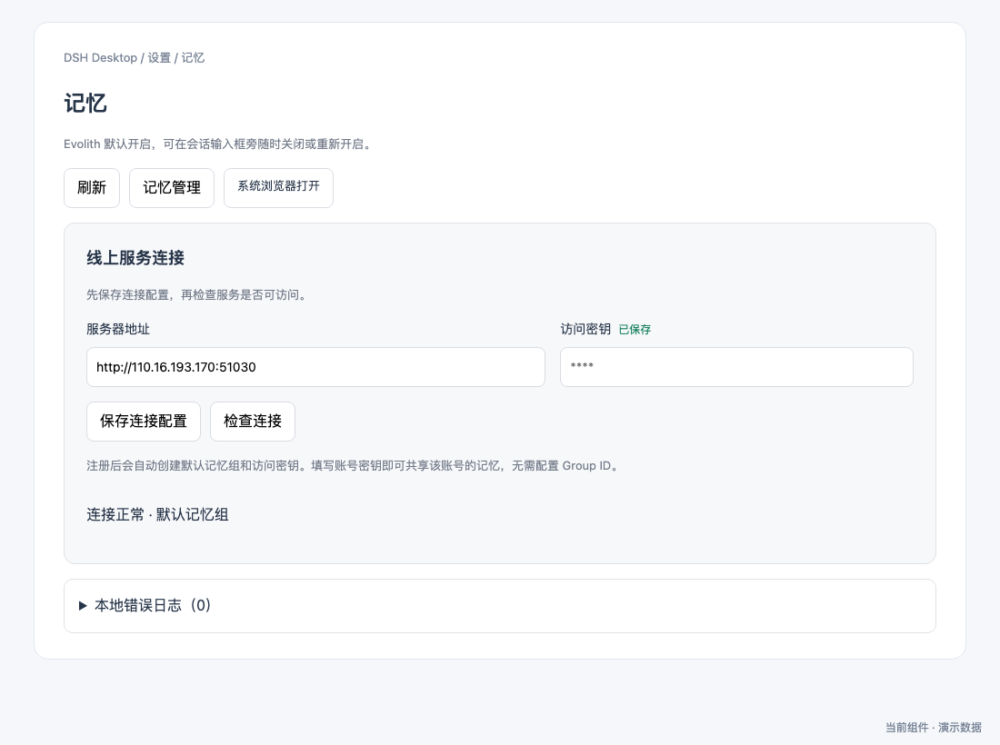
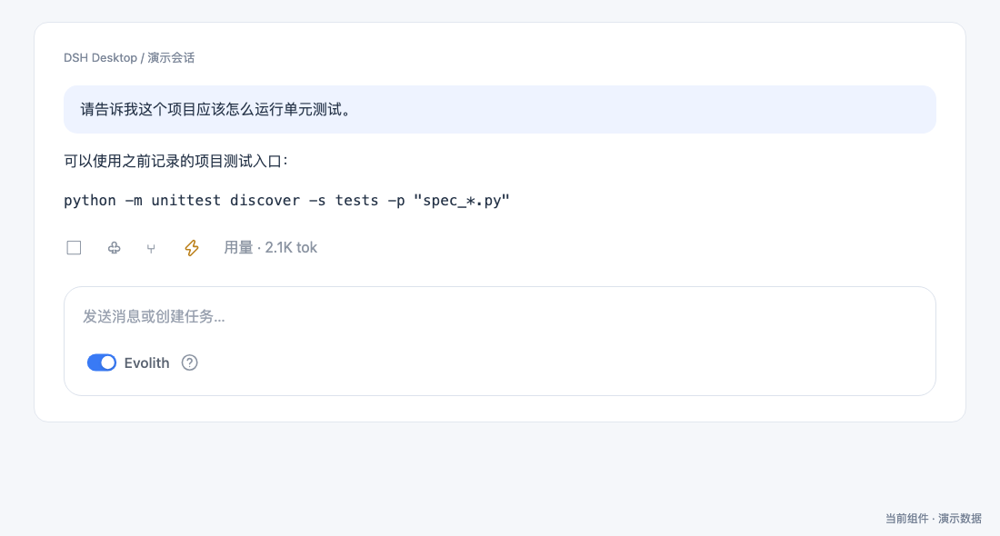
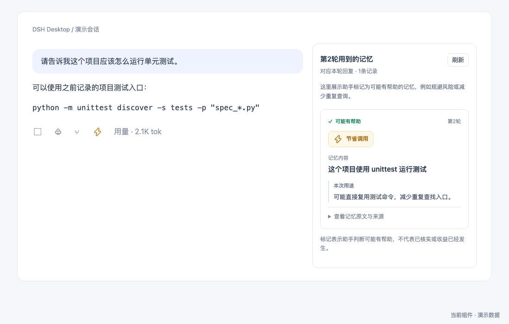

# Evolith 安装与使用指南

Evolith 为 DSH Desktop 提供跨会话记忆：整理历史经验，在后续对话中帮助助手复用信息，减少重复查找。

**第一次使用：安装插件 → 登录后台 → 复制访问密钥 → 保存并检查连接 → 开始聊天。**

当前插件版本：**0.18.24**，包名：`dsh-evolith`。本指南更新于 2026-11-26。

> 登录图来自线上未登录页面；连接设置、开关和记忆记录图使用当前组件与演示数据，布局作了简化，不包含真实密钥或聊天记录。实际界面可能因 DSH 版本不同略有差异。

## 1. 安装插件

1. 打开 DSH Desktop，点击左侧 **插件**。
2. 点击右上角 **添加插件**。
3. 在输入框粘贴下面的完整仓库地址，点击 **安装**：

   ```text
   https://github.com/dataelement/dsh-evolith
   ```

4. 安装完成后，确认插件已启用，**完全退出并重新打开 DSH Desktop**。



**看到什么才算完成？** 插件列表中有 `dsh-evolith`，且开关处于启用状态。

已经安装过的用户，请先看文末的[更新方法](#7-已经安装过怎么更新)，避免同时安装新旧两个包。

## 2. 登录记忆后台

1. 用浏览器打开 [Evolith 记忆后台](http://110.16.193.170:51030/workbench)。页面上的产品名称可能显示为 **Memory**。
2. 已有账号：输入原账号（邮箱或原有用户名）和密码，点击 **登录**。
3. 新用户：切换到 **注册**，按页面要求填写信息，完成后登录。



**这里的账号密码只用于网页登录。下一步要复制的是“访问密钥”，不要把登录密码填入插件。**

## 3. 复制自己的访问密钥

1. 登录后，进入左侧 **访问密钥**。
2. 找到默认密钥，点击 **查看 / 复制**。
3. 在弹窗中点击 **复制密钥**。密钥以圆点隐藏是正常的，不必点“显示密钥”再复制。
4. 如果列表里没有可用密钥，点击 **一键生成访问密钥**，再复制新生成的密钥。



**请复制弹窗中的完整密钥，不要复制列表中的短前缀。** 同一账号的有效密钥使用同一个默认记忆组，不同账号的记忆相互隔离。无需手动创建 Group ID，也无需填写记忆模型的 API Key。

## 4. 在 DSH 中配置连接

1. 回到 DSH Desktop，打开 **设置 → 记忆**。
2. 核对服务器地址为 `http://110.16.193.170:51030`。新安装会默认填好；旧版升级会保留原地址，需要自行核对。
3. 将刚复制的个人访问密钥，粘贴到 **访问密钥** 输入框。
4. 先点击 **保存连接配置**，再点击 **检查连接**。
5. 下方显示 **连接正常** 后，即可使用。



| 项目 | 填写内容 |
| --- | --- |
| 服务器地址 | `http://110.16.193.170:51030`，不要加 `/workbench` |
| 访问密钥 | 第 3 步复制的个人访问密钥 |
| 保存后显示 `****` / 已保存 | 表示密钥已保存；留空保存会保留已有密钥 |

公司内网也可填写 `http://192.168.106.20:8001`，两个入口连接同一套账号与记忆。原来使用 `28192` 或 `28292` 地址的用户，请改为上述公网或内网入口。

**切换服务器或访问密钥后，请在已有会话里重新开启 Evolith。** 聊天模型仍按 DSH 原来的设置使用，不需要为 Evolith 另外配置记忆模型。

## 5. 开启 Evolith，正常聊天

1. 打开已有会话，或创建一个新会话，不需要重建工作区。
2. 查看输入框旁的 **Evolith** 开关：**蓝色表示开启，灰色表示关闭**。
3. 新会话默认开启。如果此前手动关闭过，请点开关重新开启。
4. 像平时一样提问和使用工具，不需要手动调用记忆接口。



第一次体验可以这样做：

1. 在实际项目对话中告诉助手一条可复用的信息，例如：“这个项目用 `python -m unittest discover -s tests -p "spec_*.py"` 跑单元测试。”
2. 正常完成当前工作。记忆会在后台整理，**不是每句话都会立刻成为一条记忆**。
3. 后续需要运行测试时，再询问测试入口，观察助手是否复用了历史信息。不要把示例命令直接用于测试方式不同的项目。

同一账号下，不同工作区和会话可以共享记忆。新会话的第一条消息也可能检索已有记忆；账号暂时没有记忆、没有匹配内容，或者助手没有标记帮助时，没有图标是正常的。

### 开关与数据范围

- **开启后**：本会话的用户消息、模型回复、工具调用及结果（包括已有历史）会发送到所配置的记忆服务器。
- **关闭后**：停止后续记忆上传；手动关闭的状态会保存。
- **重新开启**：会同步关闭期间的公共对话。已上传的数据、已插入上下文的历史记忆不会因关闭开关自动删除。
- 输入框旁的 **问号** 可以悬停查看说明。

## 6. 查看“这一轮用了什么记忆”

1. 等助手回复，查看回复下方的操作栏。
2. 在 **分支图标之后、用量之前**，可能出现盾牌或闪电图标。
3. 点击图标，右侧打开 **第 X 轮用到的记忆**，只展示对应轮次的标记。
4. 阅读 **记忆内容** 和 **本次用途**；需要时展开 **查看记忆原文与来源**。
5. 点击另一轮回复后的图标，列表会切换到那一轮。



| 标志 | 代表助手认为这条记忆可能带来的帮助 |
| --- | --- |
| 蓝色盾牌 | 避免问题，例如提醒检查易漏条件 |
| 金色闪电 | 节省调用，例如复用信息，减少重复搜索、查询或读文件 |
| 组合图标 | 两种帮助都有，操作栏仍只显示一个图标 |

**这些标记是助手对“可能有帮助”的判断，不是独立正确性验证，也不是实际省下的调用次数或费用。** 没有图标不等于连接失败，也不能单凭图标判断答案正确与否。

要查看账号里的记忆库，可在 **设置 → 记忆** 点击 **记忆管理** 或 **系统浏览器打开**，进入后台查看。回复后的图标展示的是本轮标记，后台展示的是账号中的记忆。

## 7. 已经安装过，怎么更新

1. 等当前回复结束，进入 **插件**，卸载已安装的 Evolith 插件。
2. 旧名称可能是 `dsh-memory-bridge-profile`，新名称是 `dsh-evolith`。**不要同时启用两个版本。**
3. 点击 **添加插件**，使用第 1 步的 GitHub 地址重新安装。
4. 完全退出并重新打开 DSH Desktop，再到 **设置 → 记忆** 检查连接。

原有工作区、聊天记录和记忆配置会保留，不用重新创建。插件不会因为 GitHub 有新版本就自动更新本机。

## 常见问题

| 现象 | 怎么处理 |
| --- | --- |
| 安装提示已存在 | 先卸载旧插件，再通过完整 GitHub 地址安装。 |
| 仓库无权限或下载失败 | 确认电脑能访问 GitHub，并有该仓库的访问权限。 |
| 检查连接显示 Not Found | 核对地址为 `http://110.16.193.170:51030`，不要带 `/workbench`，保存后再检查。 |
| 提示记忆密钥未填、无效或已过期 | 到后台复制完整有效密钥，在 **设置 → 记忆** 更新、保存，再检查连接。不要填写网页登录密码或聊天模型 API Key。 |
| 出现“记忆已降级 · 对话继续” | 记忆处理出错或本轮等待超过 5 秒，主对话按当前上下文继续；后台同步与错误记录保留。可检查连接，服务恢复后后续轮次自动尝试恢复。 |
| 提示 History not committed; eviction refused | 升级到 0.18.23 或更新版本，并重新打开 DSH 后继续原会话；不必删除历史。后台修复会保留无法确认已保存的内容。 |
| 已显示“连接正常”，但没有盾牌/闪电 | 图标只在该轮有收益标记时出现；第一次使用、无匹配记忆或未被助手标记时可以没有。 |
| 回复中没直接列出记忆全文 | 记忆注入内容在聊天正文中隐藏；可通过回复后的图标查看已标记的条目。 |
| 显示“弱监督判断失败”并带有 503 | 旧版会因此中断；升级到 0.18.23 后记忆异常只降级，不再阻断主对话。它与访问密钥错误不同，不必因此反复换密钥。 |
| 更新后仍看到旧界面 | 确认旧包已卸载，再完全退出并重新打开 DSH。 |

开发与测试资料：[统一测试说明](../tests/README.md) · [实现说明与版本历史](implementation-and-history.md)。安装和更新不会自动运行测试。
